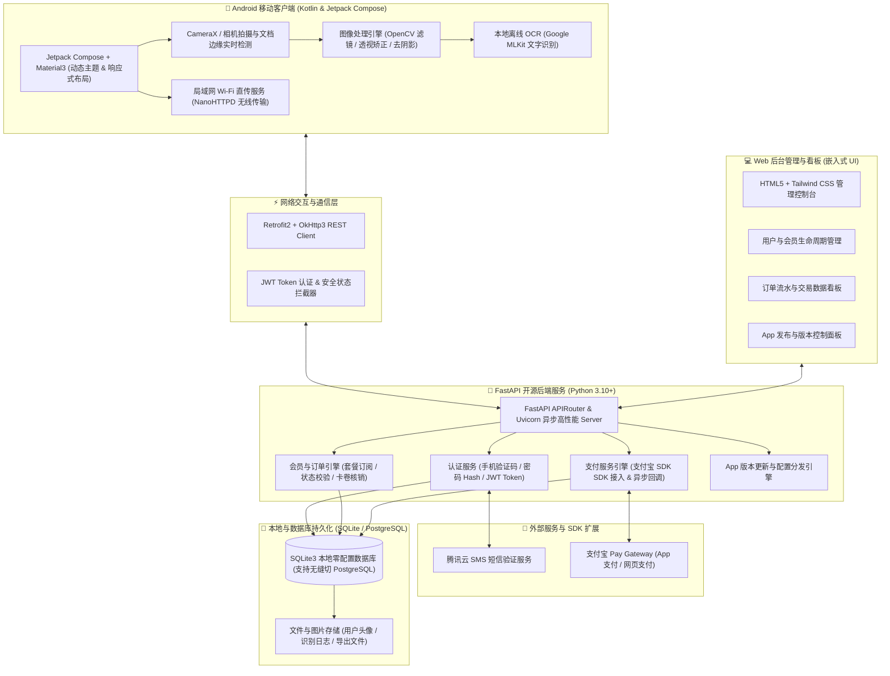
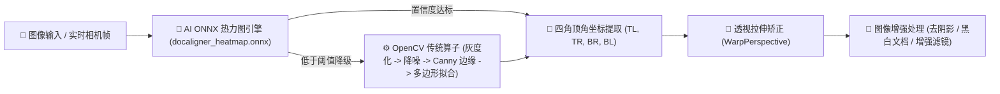

<div align="center">


# 桔子扫描 (JuZiScan) 🍊

**现代化开源智能文档扫描、OCR 文字识别与 PDF/图像工具箱 Android 应用**

[](LICENSE)
[](app)
[](https://kotlinlang.org/)
[](backend)
[](backend)
[](#-核心特性)

<p align="center">
<a href="#️-系统架构">系统架构</a> •
<a href="#-核心特性">核心特性</a> •
<a href="#-核心技术专题ai-深度学习--opencv-双引擎文档边缘检测与透视矫正">🎯 边缘检测原理</a> •
<a href="#-界面预览">界面预览</a> •
<a href="#-快速开始-android-客户端">快速开始</a> •
<a href="#-apk-打包与编译说明">APK 打包</a> •
<a href="#-项目目录结构">目录结构</a> •
<a href="#-后台管理">后台管理</a> •
<a href="#-联系作者与交流">联系作者</a> •
<a href="#-开源协议">开源协议</a>
</p>

桔子扫描 (JuZiScan) 是一款专为 **高效办公场景** 打造的 **开源智能文档扫描与处理 Android 应用**。

项目以 **Android 移动客户端 (Kotlin + Jetpack Compose)** 为核心，并配备了轻量级 **Python 后端 (FastAPI + 零配置 SQLite)** 提供用户体系、会员订阅与版本管理支持。

**支持智能边缘检测透视矫正、高精 OCR 文字识别提取、PDF & 图像处理工具箱、局域网 Wi-Fi 无线文件直传、以及完整的用户/会员/支付宝支付闭环。**

</div>

---

## 📱 界面预览

<div align="center">

| 首页 | 证件扫描 | 文档扫描 | 畸形矫正 | 会员中心 |
| :---: | :---: | :---: | :---: | :---: |
|  |  |  |  |  |

</div>

---

## 🏗️ 系统架构

JuZiScan 采用 **端云一体、模块化解耦** 架构：



### 架构亮点

- **端云一体解耦设计**：客户端支持完全离线独立运行（扫描、滤镜、MLKit OCR）；后端提供完整的用户体系、支付与版本控制支持。
- **本地优先与隐私安全**：扫描文档与图像增强均在本地设备计算完成，敏感文档无需强制上云，保护用户隐私。
- **零依赖秒级启动**：后端开箱即用内置 SQLite3 数据库，一行命令即可启动本地开发测试；生产环境支持无缝切换至 PostgreSQL。
- **嵌入式可视化后台**：后端自带现代化的轻量级 Web 管理后台，无需额外搭建前端工程即可进行用户管理、订单统计与版本发布。

---

## ✨ 核心特性

- 📄 **智能文档扫描与透视矫正**：实时检测文档边缘，支持四角透视自动拉伸平整，提供黑白、增强、去阴影等多款专业滤镜。
- 🔍 **高精 OCR 文字提取与编辑**：支持离线 (MLKit) 与在线多语言文字识别，智能分段、对比预览、一键复制与导出 Word/TXT。
- 🛠️ **多功能 PDF & 图像工具箱**：包含图片转 PDF、长图拼接、图片无损压缩、自定义水印防护、二维码扫描与生成等实用工具。
- 🌐 **局域网 Wi-Fi 无线文件直传**：手机启动局域网 HTTP 服务器，在同一 Wi-Fi 下使用电脑浏览器即可无缝传输和管理文档。
- 🆔 **专业证件扫描模式**：内置身份证、银行卡、驾驶证、营业执照等模板，支持正反面自动拼版为 A4 打印件并自动叠加防伪水印。
- 🔐 **全栈账户、会员与支付闭环**：完整实现手机号/验证码登录、账户安全、VIP 订阅套餐管理、支付宝支付以及订单状态实时回调。
- ⚡ **后台管理面板与 OpenAPI**：内置纯原生轻量 Web 后台控制台，自动生成 Swagger / ReDoc 标准 API 接口文档。

---

## 🎯 核心技术专题：AI 深度学习 + OpenCV 双引擎文档边缘检测与透视矫正

本项目最大的核心亮点在于实现了 **AI 神经网络热力图定位 + OpenCV 传统视觉算子** 的**双引擎高灵敏度文档边缘检测系统**（核心代码见 [`SimpleDocumentScanner.kt`](app/src/main/java/cn/yuandianai/juziscan/scanner/SimpleDocumentScanner.kt)）：



### 1. 🧠 第一优先：ONNX Runtime 深度学习热力图定位 (`docaligner_heatmap.onnx`)
- **模型特征**：轻量级深度卷积神经网络（仅 13MB），专为移动设备端侧实时推断优化。
- **推断原理**：将输入图像缩放到 $256 \times 256$ 尺寸送入模型，模型输出包含 **4 个独立通道的热力分布图 (Heatmap)**，分别精确映射文档的左上、右上、右下、左下 4 个顶点。
- **峰值提取算法**：通过解析每个通道热力图的高斯响应峰值（Peak Activation），即使在背景杂乱、光照不均或纸张弯曲褶皱的情况下，依然能够精准定位文档的四个关键顶点。

### 2. ⚙️ 第二兜底：OpenCV 传统计算机视觉算法降级保护
当环境光线极暗或文档与背景对比度极低导致 AI 热力图峰值未达到置信度阈值时，系统会自动无缝降级至 OpenCV 传统视觉流水线：
- **图像预处理**：高斯模糊降噪 + 自适应灰度化。
- **边缘检测与轮廓提取**：基于 Canny 算子提取边缘，通过 `findContours` 寻找最大闭合轮廓。
- **多边形逼近与凸包筛选**：利用 `approxPolyDP` 进行 4 顶点凸多边形拟合与几何角度/面积校验，确保 100% 稳定的切边成功率。

### 3. 📐 矩阵透视矫正与增强算法
- **透视变换 (Perspective Transform)**：计算目标标准矩形与实际四角坐标的单应性矩阵（Homography Matrix），通过 `warpPerspective` 将倾斜拍下的纸张自动拉伸展平。
- **智能滤镜流水线**：提供局部自适应阈值去阴影、二值化黑白高清文档、彩色对比度增强等专业扫描仪级别的图像算法处理。

---

## 📁 项目目录结构

```text
JuZiScan/
├── app/                  # Android 客户端代码 (Kotlin, Jetpack Compose, Material3)
│   ├── src/main/
│   │   ├── java/cn/yuandianai/juziscan/ # 核心业务逻辑
│   │   │   ├── ui/       # Jetpack Compose UI 视图与 ViewModel
│   │   │   ├── scan/     # 文档扫描、图像处理与 OpenCV/MLKit 算法
│   │   │   ├── data/     # 数据模型与 Retrofit 网络层
│   │   │   └── util/     # 工具类 (Wi-Fi 直传 / 文件 / 滤镜)
│   │   └── res/          # 应用资源、矢量图标与布局
│   └── build.gradle.kts  # Android 模块构建配置
├── backend/              # Python FastAPI 后端服务代码
│   ├── app/              # 后端业务逻辑与 API 路由
│   │   ├── api/v1/       # 接口路由 (Auth / Member / Payment / Admin)
│   │   ├── admin_ui/     # 嵌入式 Web 后台管理界面
│   │   ├── core/         # 配置、安全认证与日志系统
│   │   ├── models/       # Database ORM 模型 (SQLAlchemy)
│   │   ├── schemas/      # Pydantic 数据校验模式
│   │   └── services/     # 业务服务层 (支付宝 / 短信 / 会员)
│   ├── deploy/           # Nginx 生产环境配置示例
│   ├── requirements.txt  # Python 依赖清单
│   └── README.md         # 后端独立运行文档
├── docs/                 # 项目文档与资源
│   └── images/           # README 预览截图与 Logo 资源
├── build.gradle.kts      # Gradle 根目录构建脚本
├── settings.gradle.kts   # Gradle 项目设置
├── LICENSE               # MIT 开源协议
└── README.md             # 全栈项目说明文档
```

---

## 🚀 快速开始 (Android 客户端)

本项目 Android 客户端为完全独立的本地优先应用，**克隆下载后直接编译即可测试运行**，核心功能（AI 边缘检测、透视矫正、离线 OCR、图片工具箱、Wi-Fi 直传）完全无需配置后端！

### 开发环境要求
- **Android Studio**: Jellyfish (2023.3.1) 或更高版本
- **JDK Version**: `17` 或更高
- **Target SDK**: `34` (Android 14) / **Min SDK**: `24` (Android 7.0)

### 编译与测试运行步骤
1. **克隆代码仓库**：
   ```bash
   git clone https://github.com/ucmao/juziscan.git
   ```
2. **导入项目**：打开 **Android Studio**，点击 `Open` 选择 `JuZiScan` 项目根目录。
3. **依赖同步**：等待 Gradle Sync 完成依赖自动加载。
4. **运行测试**：连接 Android 实体手机（开启 USB 调试）或启动 Android 模拟器，点击顶部 **Run 'app'** 即可直接体验。

---

## 📦 APK 打包与编译说明

若需打出可在真实手机上安装的 Release 版本 APK，支持以下两种打包方式：

### 方式一：命令行一键编译 (推荐)
在项目根目录下运行 Gradle 打包指令：
```bash
# macOS / Linux
./gradlew assembleRelease

# Windows
gradlew.bat assembleRelease
```
编译生成的 APK 导出路径为：`app/build/outputs/apk/release/app-release-unsigned.apk`

### 方式二：Android Studio 图形化打包
1. 在 Android Studio 顶部菜单栏选择 **Build** -> **Generate Signed Bundle / APK...**
2. 选择 **APK** 并点击 **Next**
3. 选择或新建你的 Keystore 密钥签名文件，勾选 `release` 构建变体即可导出完成打包。

---

## ⚙️ 进阶：轻量级后端服务部署与前后端联调

如果你需要体验用户登录注册、VIP 会员订阅闭环、管理后台或版本更新检测，可快速启动配套的轻量级后端服务：

### 1. 快速启动 (SQLite 零配置)
```bash
cd backend

# 1. 创建并激活 Python 虚拟环境
python3 -m venv .venv
source .venv/bin/activate  # Linux / macOS (Windows 请使用 .venv\Scripts\activate)

# 2. 安装依赖
pip install -r requirements.txt

# 3. 复制环境变量配置文件 (关键步骤)
cp .env.example .env

# 4. 启动后端服务
uvicorn app.main:app --reload --host 0.0.0.0 --port 18001
```

### 2. 详细配置与 PostgreSQL / 支付秘钥配置指南
关于后端配置项详解、从 SQLite 切换至 PostgreSQL、支付宝 SDK 及腾讯云短信秘钥配置，请参阅：
👉 **[后端独立部署与配置指南 (`backend/README.md`)](backend/README.md)**

---

## 💻 后台管理

服务启动后，在浏览器访问 [http://127.0.0.1:18001/](http://127.0.0.1:18001/) 即可进入 Web 可视化管理控制台（默认管理员账号：`admin` / 密码：`admin123`）。

---

## 📬 联系作者与交流

如果您在开发、使用或接入过程中遇到任何问题，欢迎通过以下渠道交流与反馈：

- **微信**：csdnxr
- **QQ**：294323976
- **邮箱**：[leoucmao@gmail.com](mailto:leoucmao@gmail.com)
- **Bug 报告与需求建议**：欢迎在 GitHub 提交 [Issues](https://github.com/ucmao/juziscan/issues)
- **官方仓库**：[JuZiScan Repository](https://github.com/ucmao/juziscan)

---

## 📄 开源协议

本项目基于 [MIT License](LICENSE) 协议开源。你可以自由下载、修改和在个人或商业项目中免费使用。

- **GitHub Author**: [@ucmao](https://github.com/ucmao)
- **Repository**: [ucmao/juziscan](https://github.com/ucmao/juziscan)
