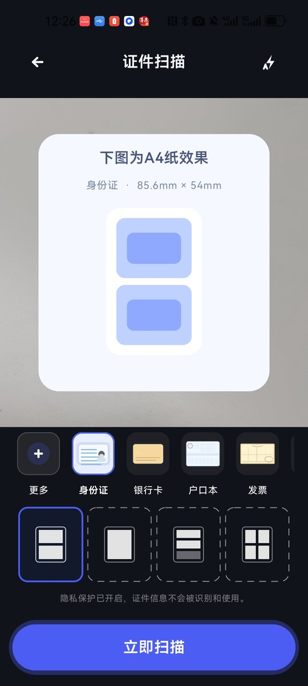
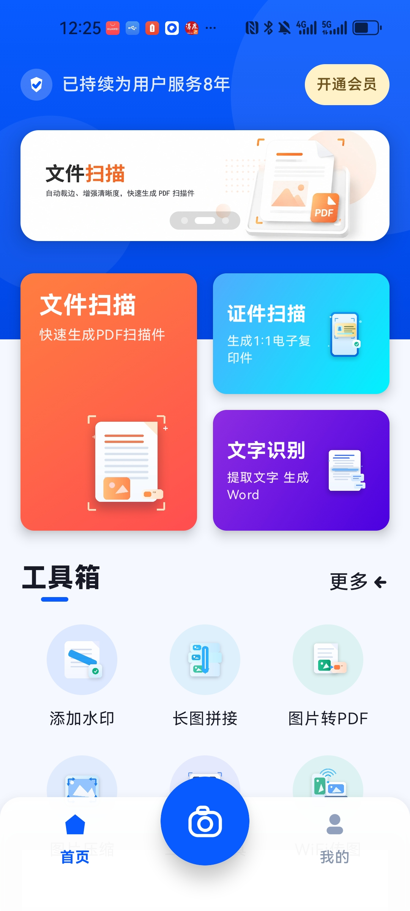
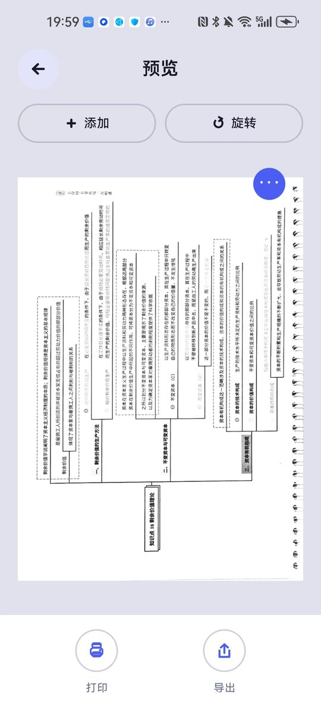
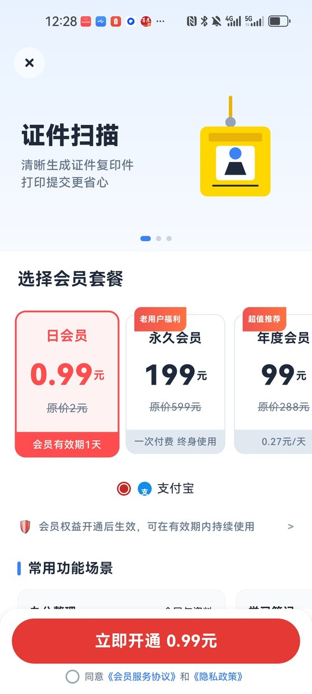
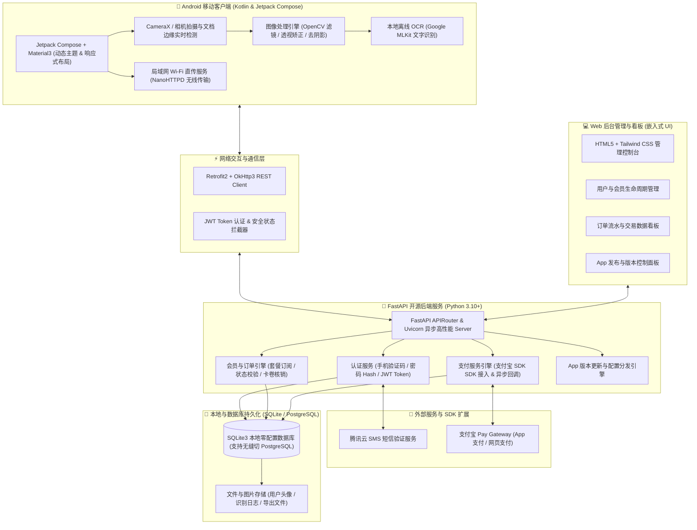

<div align="center">


# 桔子扫描 (JuZiScan) 🍊

**现代化全栈开源智能文档扫描、OCR 文字识别与 PDF/图像工具箱工作台**

[](LICENSE)
[](app)
[](https://kotlinlang.org/)
[](backend)
[](backend)
[](#-核心特性)

<p align="center">
<a href="#️-系统架构">系统架构</a> •
<a href="#-核心特性">核心特性</a> •
<a href="#-界面预览">界面预览</a> •
<a href="#-快速开始">快速开始</a> •
<a href="#-项目目录结构">目录结构</a> •
<<<<<<< HEAD
<a href="#-后台管理与-api-文档">后台管理</a> •
<a href="#-开源协议与联系作者">联系作者</a>
=======
<a href="#-联系作者与交流">联系作者与交流</a> •
<a href="#-开源协议">开源协议</a>
>>>>>>> 0e95cdd (docs: 完善 README 说明文档与 Logo、应用截图、联系方式及 LICENSE 协议)
</p>

桔子扫描 (JuZiScan) 是一款专为高效办公与个人文档管理打造的 **全栈开源智能文档扫描与处理工作台**。

提供包含 **Android 移动客户端 (Kotlin + Jetpack Compose)** 与 **Python 后端 (FastAPI + SQLite/PostgreSQL)** 的完整解决方案。

**支持智能边缘检测透视矫正、高精 OCR 文字识别提取、PDF & 图像处理工具箱、局域网 Wi-Fi 无线文件直传、以及完整的用户/会员/支付宝支付闭环。**

</div>

---

## 📱 界面预览

<div align="center">

| 首页与扫码 | 智能扫描与编辑 | OCR 文字提取 | PDF 工具箱 | 个人与会员中心 |
| :---: | :---: | :---: | :---: | :---: |
|  |  |  |  |  |

</div>

---

## 🏗️ 系统架构

JuZiScan 采用 **端云一体、模块化解耦** 架构：



### 架构亮点

- **端云一体解耦设计**：客户端支持完全离线独立运行（扫描、滤镜、MLKit OCR）；后端提供完整的用户体系、支付与版本控制支持。
- **本地优先与隐私安全**：扫描文档与图像增强均在本地设备计算完成，敏感文档无需强制上云，保护用户隐私。
- **零依赖秒级启动**：后端开箱即用内置 SQLite3 数据库，一行命令即可启动本地开发测试；生产环境支持无缝切换至 PostgreSQL。
- **嵌入式可视化后台**：后端自带现代化的轻量级 Web 管理后台，无需额外搭建前端工程即可进行用户管理、订单统计与版本发布。

---

## ✨ 核心特性

- 📄 **智能文档扫描与透视矫正**：实时检测文档边缘，支持四角透视自动拉伸平整，提供黑白、增强、去阴影等多款专业滤镜。
- 🔍 **高精 OCR 文字提取与编辑**：支持离线 (MLKit) 与在线多语言文字识别，智能分段、对比预览、一键复制与导出 Word/TXT。
- 🛠️ **多功能 PDF & 图像工具箱**：包含图片转 PDF、长图拼接、图片无损压缩、自定义水印防护、二维码扫描与生成等实用工具。
- 🌐 **局域网 Wi-Fi 无线文件直传**：手机启动局域网 HTTP 服务器，在同一 Wi-Fi 下使用电脑浏览器即可无缝传输和管理文档。
- 🆔 **专业证件扫描模式**：内置身份证、银行卡、驾驶证、营业执照等模板，支持正反面自动拼版为 A4 打印件并自动叠加防伪水印。
- 🔐 **全栈账户、会员与支付闭环**：完整实现手机号/验证码登录、账户安全、VIP 订阅套餐管理、支付宝支付以及订单状态实时回调。
- ⚡ **后台管理面板与 OpenAPI**：内置纯原生轻量 Web 后台控制台，自动生成 Swagger / ReDoc 标准 API 接口文档。

---

## 📁 项目目录结构

```text
JuZiScan/
├── app/                  # Android 客户端代码 (Kotlin, Jetpack Compose, Material3)
│   ├── src/main/
│   │   ├── java/cn/yuandianai/juziscan/ # 核心业务逻辑
│   │   │   ├── ui/       # Jetpack Compose UI 视图与 ViewModel
│   │   │   ├── scan/     # 文档扫描、图像处理与 OpenCV/MLKit 算法
│   │   │   ├── data/     # 数据模型与 Retrofit 网络层
│   │   │   └── util/     # 工具类 (Wi-Fi 直传 / 文件 / 滤镜)
│   │   └── res/          # 应用资源、矢量图标与布局
│   └── build.gradle.kts  # Android 模块构建配置
├── backend/              # Python FastAPI 后端服务代码
│   ├── app/              # 后端业务逻辑与 API 路由
│   │   ├── api/v1/       # 接口路由 (Auth / Member / Payment / Admin)
│   │   ├── admin_ui/     # 嵌入式 Web 后台管理界面
│   │   ├── core/         # 配置、安全认证与日志系统
│   │   ├── models/       # Database ORM 模型 (SQLAlchemy)
│   │   ├── schemas/      # Pydantic 数据校验模式
│   │   └── services/     # 业务服务层 (支付宝 / 短信 / 会员)
│   ├── deploy/           # Nginx 生产环境配置示例
│   ├── requirements.txt  # Python 依赖清单
│   └── README.md         # 后端独立运行文档
├── docs/                 # 项目文档与资源
│   └── images/           # README 预览截图与 Logo 资源
├── build.gradle.kts      # Gradle 根目录构建脚本
├── settings.gradle.kts   # Gradle 项目设置
├── LICENSE               # MIT 开源协议
└── README.md             # 全栈项目说明文档
```

---

## 🚀 快速开始

### 1. Android 客户端

#### 开发环境要求
- **Android Studio**: Jellyfish (2023.3.1) 或更高版本
- **JDK Version**: `17` 或更高
- **Target SDK**: `34` (Android 14) / **Min SDK**: `24` (Android 7.0)

#### 编译与运行
1. 使用 **Android Studio** 打开 `JuZiScan` 根目录。
2. 等待 Gradle Sync 完成，加载所有 Kotlin 和 Compose 依赖。
3. 连接 Android 手机（开启 USB 调试）或启动 Android 模拟器。
4. 点击 **Run 'app'** 运行客户端。

---

### 2. FastAPI 后端 API (零配置启动)

#### 开发环境要求
- **Python**: `3.10` / `3.11` / `3.12`

#### 步骤说明

进入 `backend/` 目录：

```bash
cd backend

# 1. 创建并激活 Python 虚拟环境
python3 -m venv .venv
source .venv/bin/activate  # Linux / macOS
# .venv\Scripts\activate   # Windows

# 2. 安装依赖
pip install -r requirements.txt

# 3. 复制环境变量配置文件
cp .env.example .env

# 4. 启动后端开发服务器
uvicorn app.main:app --reload --host 0.0.0.0 --port 18001
```

后端的 SQLite 数据库会在初次启动时自动创建并完成数据初始化（含默认管理员账号）。
<<<<<<< HEAD
=======

---

## 📬 联系作者与交流

如果您在开发、使用或接入过程中遇到任何问题，欢迎通过以下渠道交流与反馈：

- **微信**：csdnxr
- **QQ**：294323976
- **邮箱**：[leoucmao@gmail.com](mailto:leoucmao@gmail.com)
- **Bug 报告与需求建议**：欢迎在 GitHub 提交 [Issues](https://github.com/ucmao/juziscan/issues)
- **官方仓库**：[JuZiScan Repository](https://github.com/ucmao/juziscan)
>>>>>>> 0e95cdd (docs: 完善 README 说明文档与 Logo、应用截图、联系方式及 LICENSE 协议)

---

## 💻 后台管理与 API 文档

<<<<<<< HEAD
服务启动后，可以通过浏览器访问以下入口：

- 🖥️ **Web 可视化后台管理面板**：[http://127.0.0.1:18001/](http://127.0.0.1:18001/)
  - **默认管理员账号**：`admin`
  - **默认管理员密码**：`admin123`
- 📖 **Swagger OpenAPI 交互式文档**：[http://127.0.0.1:18001/docs](http://127.0.0.1:18001/docs)
- 📑 **ReDoc 规范文档**：[http://127.0.0.1:18001/redoc](http://127.0.0.1:18001/redoc)

---

## 📄 开源协议与联系作者

本项目基于 [MIT License](LICENSE) 协议开源。你可以自由下载、修改和在个人或商业项目中免费使用。

- **GitHub Author**: [@ucmao](https://github.com/ucmao)
- **Repository**: [ucmao/juziscan](https://github.com/ucmao/juziscan)
=======
本项目基于 [MIT License](LICENSE) 协议开源。你可以自由下载、修改和在个人或商业项目中免费使用。

>>>>>>> 0e95cdd (docs: 完善 README 说明文档与 Logo、应用截图、联系方式及 LICENSE 协议)
