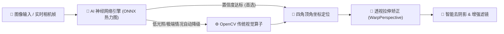
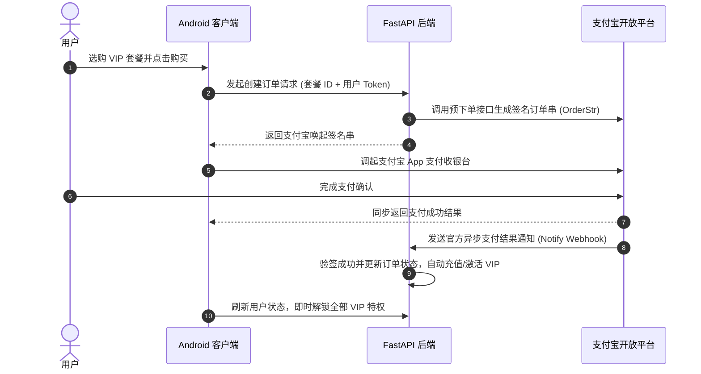

<div align="center">


# 桔子扫描 (JuZiScan) 🍊

**商业级开源智能文档扫描、OCR 文字识别与 PDF/图像工具箱 Android 应用**

[](LICENSE)
[](app)
[](https://kotlinlang.org/)
[](#-商业变现与支付闭环)
[](#-核心特性)
[](#-核心技术专题ai-深度学习--opencv-双引擎文档边缘检测与透视矫正)

<p align="center">
<a href="#-界面预览">界面预览</a> •
<a href="#-核心特性">核心特性</a> •
<a href="#-核心技术专题ai-深度学习--opencv-双引擎文档边缘检测与透视矫正">核心切边算法</a> •
<a href="#-商业变现与支付闭环">支付闭环</a> •
<a href="#-小白上手3-步运行客户端">快速开始</a> •
<a href="#-apk-一键打包">APK 打包</a> •
<a href="#-联系作者与交流">联系作者</a>
</p>

**桔子扫描 (JuZiScan)** 是一款专为高效办公与个人隐私打造的 **商业级智能文档扫描与全栈 Android 应用**。

内置经商用验证的 **AI深度学习+OpenCV双引擎算法**，杂乱背景与反光场景下依然毫米级精准贴合。  
**100%本地运行杜绝隐私泄露** • 内置**支付宝支付与VIP订阅闭环**拿来即用
</div>

---

## 📱 界面预览

<div align="center">

| 首页 | 证件扫描 | 文档扫描 | 畸形矫正 | 会员中心 |
| :---: | :---: | :---: | :---: | :---: |
|  |  |  |  |  |

</div>

---

## ✨ 核心特性

- **智能扫描**：实时捕捉纸张边缘并自动完成透视矫正，内置去阴影、黑白文档、高清增强等多款专业图像滤镜。
- **智能手拍与自动拍**：文件扫描默认实时识别四角、手动点击快门，拍后可连续扫描；也可切换自动拍。点击已拍缩略图统一预览、调整边缘和导出多页文档。
- **离线OCR**：内置端侧 MLKit 引擎秒级离线提取文本，支持高精度智能段落排版、一键快速复制与多格式导出。
- **证件拼版**：支持身份证、银行卡、驾驶证等常用证件正反面 1:1 智能 A4 拼版，自带防盗用自定义安全水印。
- **实用工具**：集成长图无缝拼接、图片批量转 PDF、智能无损图片压缩、多格式二维码生成与识别等高频工具箱。
- **支付闭环**：开箱支持支付宝 App 唤起支付、服务端异步验签回调、VIP 订单自动履约与会员特权秒级下发。
- **隐私安全**：核心图像处理与文本识别 100% 在手机端侧芯片本地完成，零数据强制上云，彻底杜绝隐私泄露。

---

## 🎯 核心技术专题：AI深度学习+OpenCV双引擎文档边缘检测与透视矫正

> 💡 **本项目核心价值亮点**：很多开源扫描项目仅采用简单的 OpenCV Canny 算子，在复杂背景、弯曲反光、杂物干扰下切边极易失败。本项目经过**真实商业应用市场上架验证**，采用 **AI 热力图定位 + OpenCV 传统视觉** 双保险机制，保证了极高的贴合度与稳定性。



### 1. 第一优先：ONNX 深度学习热力图定位 (`docaligner_heatmap.onnx`)
- **端侧超轻模型**：仅 13MB 深度卷积神经网络，专为手机 CPU/GPU 实时推断优化，毫秒级响应。
- **热力图峰值算法**：模型输出 4 通道关键点热力图，精准锁定左上、右上、右下、左下 4 个顶点。即便在**背景杂乱、纸张弯曲、阴影遮挡**下依然精准识别。

### 2. 第二兜底：OpenCV 传统计算机视觉降级保护
- 当光线极暗或对比度极低、AI 热力图置信度不足时，系统自动无缝切换为 OpenCV 轮廓提取流水线（高斯降噪 $\rightarrow$ 自适应阈值 $\rightarrow$ 最大多边形逼近），确保 100% 稳定的切边体验。

### 3. 矩阵透视矫正与去阴影滤镜
- 计算单应性矩阵（Homography Matrix）进行透视平整拉伸，配合自适应局部去阴影算法，输出媲美物理扫描仪的清晰文档。

---

## 💰 商业变现与支付闭环

JuZiScan 提供了一套**开箱即用的完整商业化变现方案**，无需从零对接复杂的支付流程：



- **全流程打通**：包含手机号验证码/密码登录、VIP 套餐订阅、支付宝唤端支付、服务端异步回调入账及状态同步。
- **开箱即用后台**：配套纯原生轻量 Web 控制台，实时查看订单流水、用户 VIP 状态及版本更新发布。

---

## 🚀 小白上手：3 步运行客户端

本项目为**本地优先（Local-First）**架构，**运行 App 完全不需要部署后端**，克隆后打开即可体验全部扫描核心功能！

### 准备环境
- 安装 [Android Studio](https://developer.android.com/studio) (推荐 Jellyfish 或更新版本)
- JDK 17 或以上

### 快速跑起来
1. **克隆项目到本地**：
   ```bash
   git clone https://github.com/ucmao/juziscan.git
   ```
2. **打开项目**：启动 Android Studio，点击 **Open**，选择 `juziscan` 根目录，等待 Gradle 依赖加载完成。
3. **一键运行**：手机开启“USB 调试”连接电脑（或启动模拟器），点击顶部绿色 **Run 'app'** (▶️) 按钮，即可在手机上体验！

---

## 📦 APK 一键打包

如果你想将 App 打包成安装包发送给他人体验：

- **方式一（命令行）**：
  ```bash
  # macOS / Linux
  ./gradlew assembleRelease

  # Windows
  gradlew.bat assembleRelease
  ```
  导出的 APK 路径：`app/build/outputs/apk/release/`

- **方式二（Android Studio 菜单）**：  
  点击顶部菜单 **Build** $\rightarrow$ **Generate Signed Bundle / APK** $\rightarrow$ 选择 **APK** 打包即可。

---

## ⚙️ 可选进阶：后端服务与管理后台

> 📌 **注**：App 的扫描、矫正、OCR、工具箱等本地功能完全独立运行。仅当需要体验**用户登录、支付宝支付闭环、Web 管理后台**时才需启动后端。

1. **启动后端（极简 SQLite 零配置）**：
   ```bash
   cd backend
   python3 -m venv .venv
   source .venv/bin/activate       # Windows 使用 .venv\Scripts\activate
   pip install -r requirements.txt
   cp .env.example .env
   uvicorn app.main:app --reload --host 0.0.0.0 --port 18001
   ```
2. **访问后台控制台**：浏览器打开 `http://127.0.0.1:18001`（默认账号：`admin` / 密码：`admin123`）。
3. 详细配置请参阅 👉 [后端独立指南 (`backend/README.md`)](backend/README.md)。

---

## 📬 联系作者与交流

如果您在体验、二开或商用接入过程中遇到问题，欢迎交流：

- **微信**：csdnxr
- **QQ**：294323976
- **邮箱**：[leoucmao@gmail.com](mailto:leoucmao@gmail.com)
- **GitHub Issues**：[提交问题与建议](https://github.com/ucmao/juziscan/issues)

---

## 📄 开源协议与免责声明

- **开源协议**：本项目基于 [MIT License](LICENSE) 协议开源。无论个人学习还是商业用途，均可**免费使用、修改和分发**，但请保留原作者版权声明。
- **免责声明**：本项目代码及内置模型仅供技术学习、研究与合法商业参考。使用者在引入商业生产环境时，应自行评估网络安全、数据隐私及支付业务合规性，作者不对因使用本软件造成的任何直接或间接损失承担责任。
