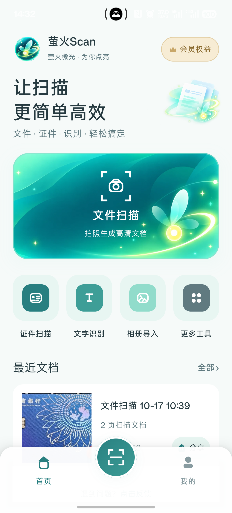
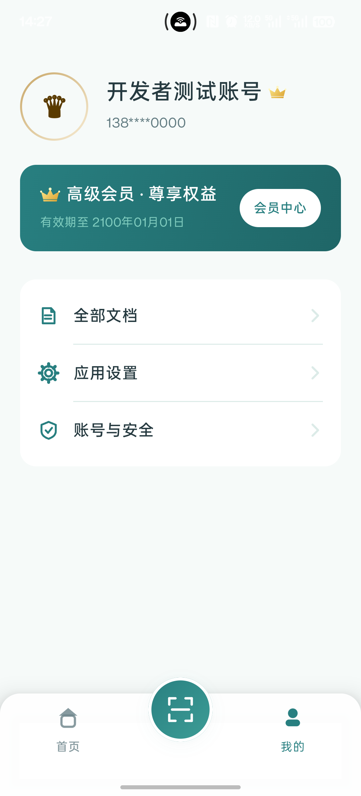
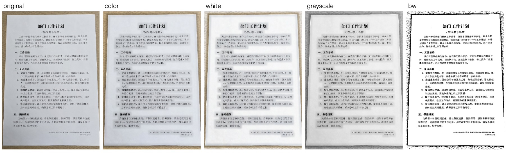

<div align="center">


# 萤火Scan · Firefly Scan

**萤火微光 · 为你点亮**

Android 文档扫描与处理应用：从拍摄、校正、增强，到整理与导出。

[](app)
[](app)
[](LICENSE)

[功能介绍](#功能介绍) · [界面预览](#界面预览) · [快速开始](#快速开始) · [技术架构](#技术架构) · [开发文档](#开发文档)

</div>

## 项目简介

**萤火Scan** 以文件扫描为核心，提供文档边缘检测、透视矫正、图像风格处理、多页管理、文字识别和 PDF/图片导出等功能。日常扫描和图像处理主要在 Android 设备本地完成；账号、会员与支付相关功能由可选的后端服务支持。

本仓库基于 [JuZiScan](https://github.com/ucmao/juziscan) 持续开发，已完成**萤火Scan 品牌主题与新版首页**；其他功能页面将依照 [产品视觉规范](design.md) 逐步统一。

## 界面预览

<div align="center">

| 首页 | 文件扫描主入口 | 我的 |
| :---: | :---: | :---: |
|  |  |  |

<sub>截图来自品牌改版第二轮的实际界面验证。</sub>

</div>

## 功能介绍

| 功能 | 当前能力 |
| --- | --- |
| **文件扫描** | 基于 CameraX 拍摄或从相册导入，支持智能手拍、自动拍、连续扫描与文档边缘检测 |
| **文档校正** | 自动检测边缘、手动调整四角，进行裁剪与透视矫正 |
| **五种图像风格** | 原图、彩色增强、白纸增强、灰度、黑白文档；可设置默认风格，并逐页修改 |
| **多页文档管理** | 预览、旋转、重排、删除、历史记录与续扫；扫描过程中逐步保存 |
| **导出与分享** | PDF、JPG、PNG、TIFF、HEIF；支持不同文件质量、分享及水印配置 |
| **识别功能** | 基于 ML Kit 的中文 OCR、证件扫描与表格识别入口 |
| **常用工具** | 图片转 PDF、长图拼接、图片压缩、二维码工具、Wi-Fi 传图 |
| **账号与会员** | 可对接 FastAPI 后端，支持登录、会员状态与支付宝相关流程 |

### 五种文档图像风格

针对日常文档、发黄纸张、票据和黑白文字等场景，提供不同处理风格。图像处理基于 OpenCV，与现有扫描和导出流程衔接。



<sub>从左至右：原图、彩色增强、白纸增强、灰度、黑白文档。样例为测试图片。</sub>

实现说明和验证记录：[文件扫描图片处理 v1](docs/issue-3-document-styles.md)。

## 技术架构

| 模块 | 主要技术 |
| --- | --- |
| Android 客户端 | Kotlin、Jetpack Compose、Material 3 |
| 拍摄与文档处理 | CameraX、ONNX Runtime、OpenCV |
| 中文 OCR | Google ML Kit |
| 二维码 | ZXing |
| 可选后端 | Python、FastAPI、SQLite / PostgreSQL |
| 会员与支付 | Android 支付宝 SDK、后端订单与支付接口 |

扫描、图像处理和文档管理以客户端为核心；使用账号、会员或支付功能时，需要相应的后端配置。

## 快速开始

### 环境要求

- Android Studio、JDK 17、项目 Gradle 配置所需 Android SDK
- Android 8.0（API 26）及以上设备或模拟器

### 获取代码

```bash
git clone https://github.com/bronya19c818/firefly-scan.git
cd firefly-scan
```

使用 Android Studio 打开仓库根目录，等待 Gradle 同步，再运行 **app**。

Windows PowerShell 构建 Debug APK：

```powershell
.\gradlew.bat :app:assembleDebug
```

macOS / Linux：

```bash
./gradlew :app:assembleDebug
```

构建结果位于 `app/build/outputs/apk/debug/`。正式发布需自行配置 APK 签名。

### 可选后端

本地文件扫描和图片处理不依赖后端。若需要登录、会员或支付功能，参阅 [后端部署指南](backend/README.md)。

Android 模拟器调试时，可通过 `JUZISCAN_API_BASE_URL` 配置接口根地址，例如 `http://10.0.2.2:18001`。此字段名沿用当前代码，客户端会自行追加 API 路径，详见 [BACKEND.md](BACKEND.md)。

## 开发文档

- [产品视觉设计规范](design.md)：品牌、配色、首页和后续页面的设计基线
- [五种图像风格与验证记录](docs/issue-3-document-styles.md)：处理规则、保存机制、测试样张及结果
- [后端配置与部署](backend/README.md)：账号、数据库及支付服务

项目持续迭代中：新版品牌首页已完成，扫描、预览、编辑、导出、工具及设置等页面将继续统一视觉样式。问题与改进需求可通过 [GitHub Issues](https://github.com/bronya19c818/firefly-scan/issues) 提交。

## 开源许可与致谢

本项目基于 [ucmao/JuZiScan](https://github.com/ucmao/juziscan) 继续开发，感谢原作者及相关开源组件维护者。

仓库遵循 [MIT License](LICENSE)，使用、修改与分发时须保留适用的版权和许可声明。
