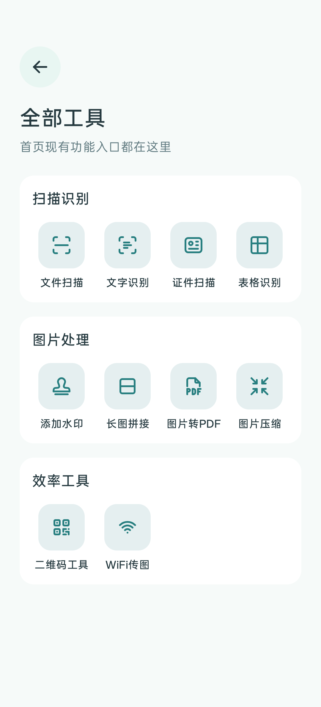
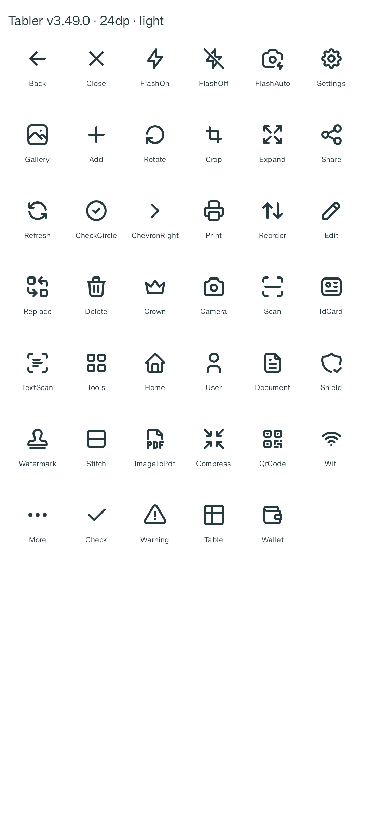
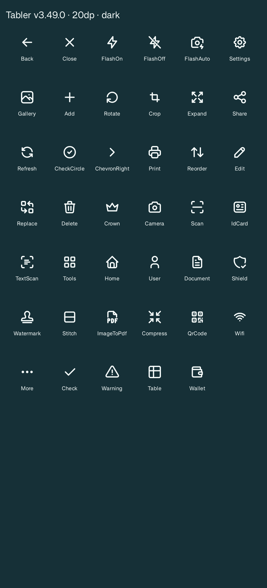
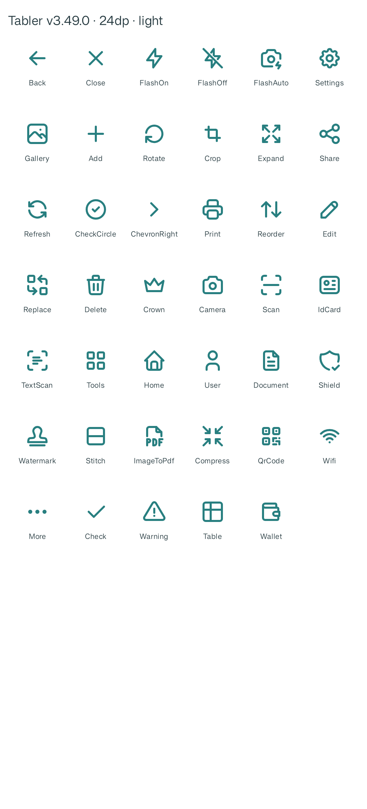
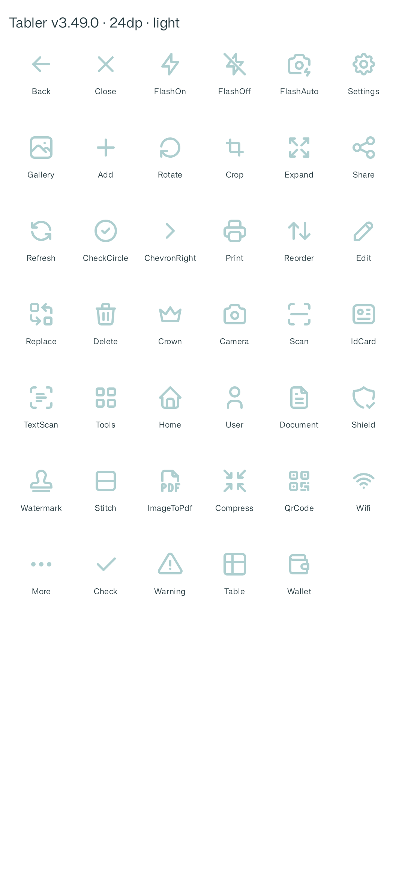
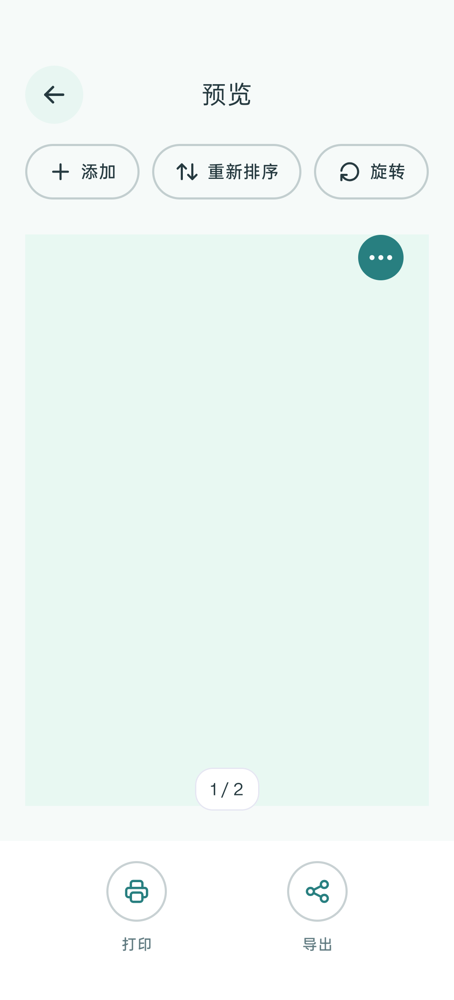
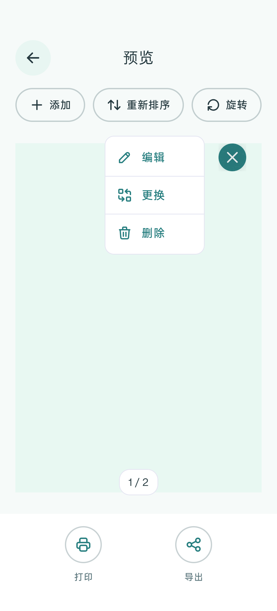
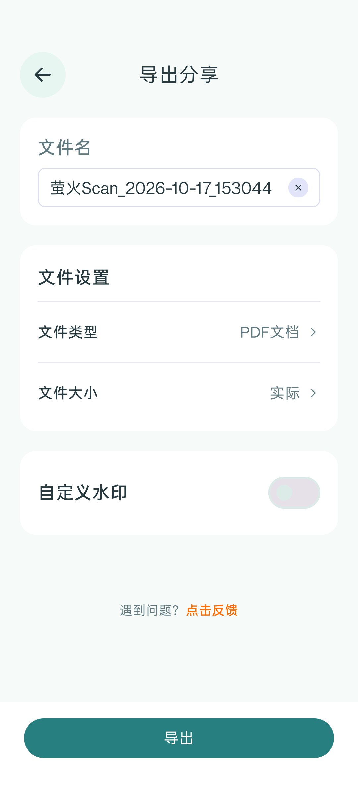

# 萤火Scan 图标系统 V1.0 验证记录

日期：2026-10-17。设备：OnePlus PKR110，Android 16 / API 36，1080×2376；设备当前显示密度 480dpi。

## 实际改动

- 固定 Tabler Icons v3.49.0，按需导入 41 个 outline SVG，转换为 24×24 / 2 单位笔画的 VectorDrawable。原始路径、圆端点、圆连接及透明画布保持一致。
- `FireflyIcon` 统一资源、尺寸、主题色、选中与禁用外观；18 个既有公共组件保留调用签名。完成 35 个既有 Compose 文件及新增组件的图标巡检，映射见 [图标系统](icon-system.md)。
- 首页保留 A1 底座与品牌素材；设置箭头、会员勾选、工具位图、手绘通用图标统一替换。真实取景、裁剪、证件版式、二维码生成和业务回调继续沿用原实现。
- “全部工具”改为每行四个等宽入口：52dp 底座、24dp 图标、12sp 标签、8dp 列间距。扫描识别四项、图片处理四项分别在一行，十个工具在该设备上可在同屏显示。

## 验证结果

| 检查 | 结果与证据 |
|---|---|
| 官方源与转换 | 41 个 SVG 哈希匹配固定提交；离线重新生成成功，XML 路径与官方源一致 |
| Windows 检出 | `.gitattributes` 固定 LF；以 `core.autocrlf=true` 的 Git 检出过滤重新校验，41 个 SVG 和两份许可哈希保持一致 |
| APK 许可 | Debug APK 中 `assets/licenses/tabler-icons.txt` 与官方 MIT 许可逐字节一致 |
| Debug 构建 | `assembleDebug`、`assembleDebugAndroidTest` 通过，见 [构建日志](images/icon-system-v1/build-debug.txt) |
| 真机端到端 | 5 项通过，见 [设备日志](images/icon-system-v1/instrumentation.txt) |
| 图标尺寸与主题 | 实际 Compose 组件生成浅/深主题 20/24/32dp 图标表，并检查宽高；另输出选中/禁用状态图标表 |
| 密度与透明区域 | Android Drawable 实际渲染 41×4＝164 张 1×–4× 图像；透明角落、有效笔画、非实心填充检查通过，跨密度透明覆盖率最大差异约 1.53 个百分点 |
| 代码审查 | 收尾复核未发现 P1/P2；重复读屏描述已修复 |

端到端测试操作实际 Activity 和系统相册选择器，检查四列顺序及六个工具入口，再检查我的、会员、设置、相机，以及文档预览、重排、编辑、风格处理、导出和格式选择。文档操作使用测试创建的两页记录，仅清理该记录；不清空现有文档或账号。

产品页截图来自真实 Android Compose 窗口；系统相册选择器使用设备全屏截图。完整的本地工件位于 `output/firefly-icons-e2e/`；仓库只保留选定界面截图、构建/设备日志与密度指标，重复运行覆盖固定名称。执行方式见 [可重复验证](icon-system.md#可重复验证与工件)。

## 选定真机截图

| 全部工具：四列紧凑布局 | 浅色 24dp 图标表 |
|---|---|
|  |  |

| 深色 20dp 图标表 | 选中状态 | 禁用状态 |
|---|---|---|
|  |  |  |

| 文档预览 | 页面操作 | 导出 |
|---|---|---|
|  |  |  |

## 验证边界

本轮为一台真机的自动化界面检查与截图复核；密度检查是该设备上 Android 渲染器的 1×–4× 渲染，不代表四台不同分辨率设备的人工验收。没有重复进行识别质量、真实支付或实体打印的完整验收。

附加 `lintDebug` 检查首次出现 `ExperimentalDetector` 内部异常（`Unexpected owner function: null`），复跑未得到有效报告，因此不计为通过；未禁用检查规则。Debug 构建和本任务端到端验收均通过。
