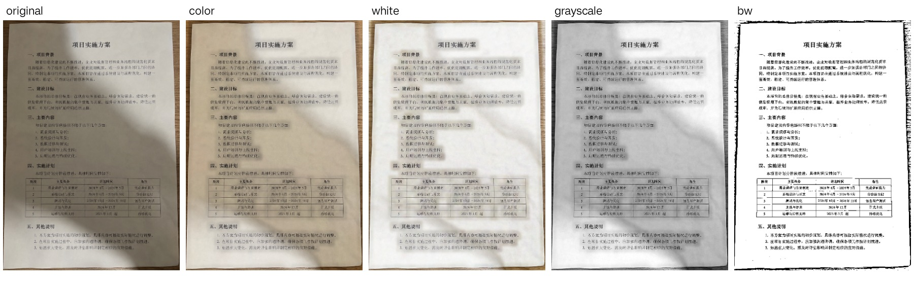
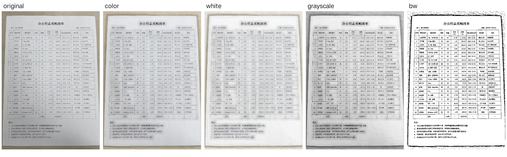
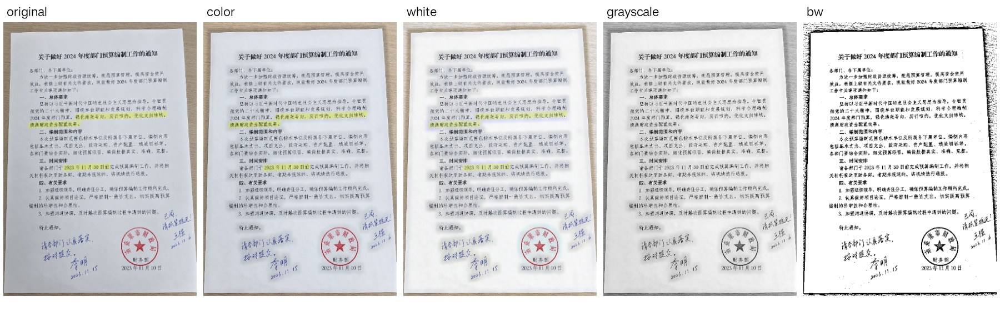
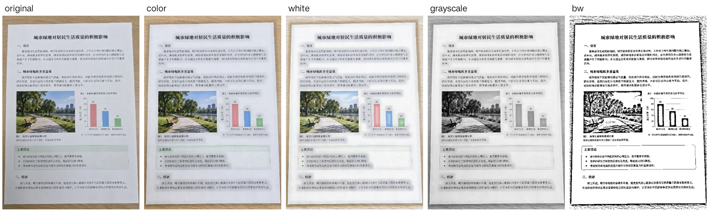

# 文件扫描图片处理 v1

范围：GitHub issue #3，基于 main c596089。仅文件扫描增加五种风格；继续使用原有 CameraX、逐页队列、JSON 清单、增量保存与按需 PDF。

## 使用方式

新拍摄和相册导入的页面在创建时固化当前默认风格，首次默认彩色增强。设置 → 默认图片处理风格可选全部五种预设；更改只影响之后新增页面。

预览右上角“···”→ 编辑 → 检测边缘 → 下一步 → 图片处理 → 完成。返回图片处理页上一层保留四角和选择，取消边缘编辑不提交修改。完成只提交本页裁剪、模式和风格，随后后台生成高清结果。

## 预设与参考差异

| 风格 | 实际处理 | 主要参数 |
|---|---|---|
| 原图 original | 仅裁剪、透视矫正 | 无增强 |
| 彩色增强 color | HSV 亮度通道背景均衡、轻度锐化 | 均衡 0.55，锐化 0.25；色相、饱和度保持 |
| 白纸增强 white | RGB 各通道背景均衡、Gamma 提亮、轻度锐化 | 均衡 0.90，Gamma 0.88，锐化 0.25 |
| 灰度 grayscale | 亮度均衡、灰阶直方图拉伸、锐化 | 0.4% / 99.6% 分位，锐化 0.40 |
| 黑白文档 bw | 高斯自适应二值化 | 窗口短边 / 16，25–101 奇数，偏置 10；保留细线不做中值滤波 |

背景估计核 sqrt(W×H)/32，限制15–101奇数，先膨胀再高斯平滑。参数集中在 DocumentStyleProcessor，预览、后台高清与导出复用同一个分发入口。

研究了 [ClearScan 源码](https://github.com/ant-cave/ClearScan/blob/main/app/src/main/java/com/clearscan/MainActivity.kt) 的背景均衡、直方图拉伸与自适应阈值思路。其当前版本为 AGPL-3.0-or-later；本实现自行编写，没有复制其源码。与其默认值相比，彩色增强降低均衡和锐化强度、不增加饱和度；白纸增强采用局部通道均衡减弱泛黄；黑白文档降低阈值偏置且省去中值滤波以保护细表格线。

## 保存与并发

- 每页保存稳定标识 original/color/white/grayscale/bw。旧 default 保留原 enhanceDocument 灰度算法，编辑器显示灰度，旧清单和缓存键保留，不做历史迁移；未知值显示及处理回退彩色增强。
- 风格/四角编辑不更改 contentRevision 和源文件；清空旧 processedImagePath、processedBitmap、previewBitmap。现有缓存键已含风格和四角，PDF 指纹已含逐页参数。
- 队列发布和会话复用缓存都校验页面 ID、contentRevision、风格、矫正模式及四角；磁盘提交仍校验当前清单缓存键，旧任务不会写入新风格缓存。
- 编辑只读取当前页的1600像素原图副本；风格页复用一次1280像素矫正图。滤镜任务串行并可取消等待，过期结果释放，处理中提示按代次保护。已交给 Compose 的显示 Bitmap 随引用释放由运行时回收。
- 完成沿用 commitPageEdits 与原子清单；不生成高清 PNG 或 PDF。高清处理入口串行执行，并提前释放各阶段 Mat，避免两个12MP页面的中间数组同时驻留。高清缓存缺失自动后台补齐，打印与PDF导出继续使用同一按需PDF入口。

## 复现

五张生成样张位于仓库 test_image/，不是手机实拍图，也不作为 OCR 正确率基准。测试固定完整四角及相同输入尺寸，每张输出五种风格，总计25张PNG。对照图每行依次为 original、color、white、grayscale、bw。

在 Windows PowerShell 中设置 Android SDK 路径后运行：

```powershell
$env:ANDROID_HOME = 'C:\Users\Lenovo\AppData\Local\Android\Sdk'
.\gradlew.bat --gradle-user-home .gradle-local :app:assembleDebug :app:assembleDebugAndroidTest :app:testDebugUnitTest :app:lintDebug
.\tools\run-document-styles-e2e.ps1 -Serial <设备序列号>
```

脚本覆盖当前一次结果，输出位于 output/document-styles-e2e/，含五张对照图、25张全尺寸结果、timings.json、编辑/设置/续扫截图、PNG导出、实际渲染PDF、跨进程恢复PDF和测试日志。构建产物由 Gradle 管理，不提交到源码。

## 验收记录

2026-10-17，OnePlus PKR110 / Android 16，真机自动化执行；没有把自动化记录当作人工实拍验收。

- Debug APK、AndroidTest APK 构建通过；既有 JVM 27项全部通过；Lint 无错误。
- 新功能5项真机用例通过，另有强制结束应用前后各1项跨进程用例通过。
- 25张结果逐输入验证5种风格哈希均不同。编辑完成返回预览155ms；本页源文件时间戳及 contentRevision 保持不变。
- 3000×4000 输入的彩色/白纸处理及编码合计3623ms，输出保留该分辨率；设备 Java 堆上限256MiB。该测试证明此设备可完成处理，不代表所有低内存设备或长时间压力测试结论。
- 21页小图验证独立风格、快速提交、过期任务隔离与缺失缓存重建；12MP另以2页验证。旧default重建结果与旧enhanceDocument算法逐像素一致。
- 实际渲染混合风格PDF，确认灰度页和保留暖色的彩色页；PNG导出、重启恢复PDF均生成可检查工件。
- 既有19项真机回归全部通过，覆盖连续拍摄5页、跨文档切换、历史续扫、旋转排序裁剪、取消编辑、删除、增量保存失败重试、缺失缓存补处理与高清导出。

### 五张样张耗时

单位ms，包含同一全图四角的透视矫正、风格、PNG编码与预览写入，不是单独滤镜内核运行时间。样张均为1055×1491。

| 输入（文件名前缀） | 场景 | 原图 | 彩色 | 白纸 | 灰度 | 黑白 |
|---|---|---:|---:|---:|---:|---:|
| 363c5e1a | 灰黄纸张/阴影 | 654 | 967 | 1462 | 691 | 199 |
| 3a5bb3f1 | 密集表格 | 1373 | 1422 | 1487 | 652 | 197 |
| 62979813 | 普通正文 | 1310 | 1346 | 1420 | 580 | 210 |
| 7d321dbb | 红章/蓝笔/荧光标记 | 1148 | 1226 | 1307 | 599 | 199 |
| 9fc56d02 | 照片/图表/正文 | 1315 | 1251 | 1290 | 611 | 207 |

原始记录：[timings.json](images/issue-3/timings.json)。其他指标位于同目录。

### 对照图与画质观察

彩色增强保持红章、蓝笔、荧光标记及照片颜色；白纸更明显提亮和减弱泛黄。密集表格黑白结果仍保留网格线，但二值化使照片和浅灰色区域失去层次；白纸/灰度在密集正文周围仍有局部底色变化，强阴影也未完全消除。原图预设保留全部原始纹理。

下列五图完整披露全部样张，未只选最佳示例。每图从左到右：原图、彩色增强、白纸增强、灰度、黑白文档。










### 尚未覆盖

系统相册选择器的完整导入操作、实际打印机输出、OCR/证件/表格工具全流程，以及强反光、失焦、严重透视的实拍画质和20页高清长时间内存曲线，仍需人工专项验收。现有默认风格固化路径和同一高清分发入口已接通；这些未执行场景不计为通过。
